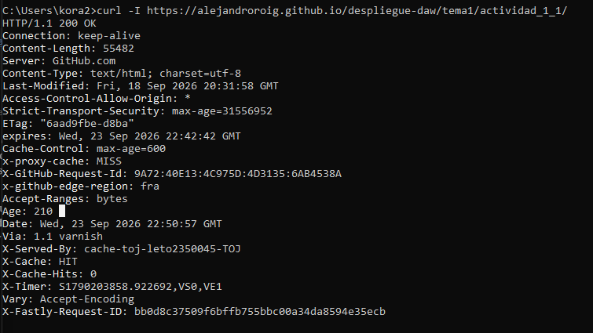
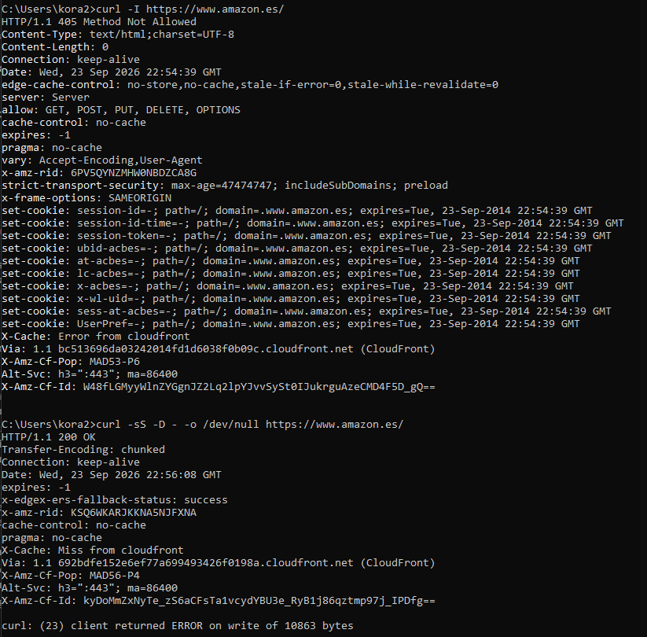

# Actividad 1.1 - Qué se puede saber de un despliegue desde fuera

## Predicciones iniciales

- ¿Esperas que sea principalmente estático o dinámico? **Dinámico**
- ¿Esperas una carga sencilla o muchas peticiones y recursos? **Carga sencilla**
- ¿Crees que podrás descubrir fácilmente cómo está desplegado? **Sí**

---

## Paso 2: Cabeceras

### Web de apuntes

- Código: `HTML`
- Content-Type: `text/html; charset=utf-8`
- Server, si aparece:
- 2 o 3 cabeceras que te den alguna pista:
  - Servidor github
  - `x-cache: HIT`
  - `Via: 1.1 varnish`
- Qué puedo afirmar a partir de ellas:

**Evidencia:**

### Amazon

- Código: `html`
- Content-Type: `text/html;charset=UTF-8`
- Server, si aparece:
- 2 o 3 cabeceras que te den alguna pista:
  - `Servidor: Server`
  - `x-cache: error from cloudfront`
  - `Via: 1.1 692bdfe152e6ef77a699493426f0198a.cloudfront.net (CloudFront)`
- Qué puedo afirmar a partir de ellas:

**Evidencia:**

---

## Paso 3: Caché

### Comparación entre dos peticiones seguidas (web de apuntes)

| Cabecera | Petición 1 | Petición 2 |
|---|---|---|
| `Content-Length` | 55482 | 55482 |
| `ETag` | `"6aad9fbe-d8ba"` | `"6aad9fbe-d8ba"` |
| `x-proxy-cache` | MISS | MISS |
| `X-Cache` | HIT | HIT |
| `Age` | 0 | 1 |
| `X-Cache-Hits` | 0 | 1 |
| `X-Served-By` | `cache-toj-leto2350037-TOJ` | `cache-toj-leto2350058-TOJ` |
| `X-Timer` (VE) | VE129 | VE1 |
| `Date` | 23:00:05 | 23:00:06 |

### Preguntas

1. **¿Hay alguna evidencia de caché, CDN o capa intermedia?**

   Sí, parece que sí. Veo palabras como "varnish" y "fastly" en las cabeceras, y también aparece `X-Cache: HIT`, que creo que significa que la página no se ha generado de nuevo, sino que se ha servido una copia que ya tenían guardada. Esto me hace pensar que hay algo intermedio entre mi ordenador y el servidor real, tipo una especie de "almacén" que guarda copias para ir más rápido.

2. **¿Qué cambia entre las dos respuestas?**

   - El número de `Age` cambió de 0 a 1. Creo que esto cuenta los segundos que lleva esa copia guardada, así que como pasó 1 segundo entre mis dos peticiones, tiene sentido que suba de 0 a 1.
   - `X-Cache-Hits` también pasó de 0 a 1. Me imagino que esto cuenta cuántas veces se ha usado esa misma copia guardada, y como la pedí dos veces, subió a 1.
   - El nombre que aparece en `X-Served-By` cambió un poco (de un número a otro parecido). Supongo que significa que no siempre me atiende exactamente la misma máquina, sino una de varias parecidas.
   - El tiempo que tardó en responder (el número que sale en `X-Timer`) fue mucho más bajo la segunda vez. Tiene sentido si la segunda vez ya tenía la copia lista y no tuvo que currárselo tanto.
   - Todo lo demás (el tamaño de la página, el identificador del contenido...) fue igual en las dos, así que la página en sí no cambió, solo cambiaron esos "datos de control" de la copia guardada.

3. **¿Qué no puedes asegurar aunque veas esas cabeceras?**

   - No sé desde cuándo existe esa copia guardada en realidad, ni cuánta gente la ha visto antes que yo — solo sé que llevaba ahí 0 y luego 1 segundo cuando yo pregunté.
   - No entiendo del todo por qué si me atendieron dos "máquinas" distintas, el contador de veces usada seguía subiendo igual, como si fuera compartido entre ellas. Puedo suponer que están conectadas de alguna forma, pero no lo puedo comprobar de verdad, solo es una idea mía.
   - No tengo forma de saber si el servidor "de verdad" (el original, no la copia) sigue teniendo la última versión actualizada o si hace tiempo que nadie lo consulta — solo veo lo que me dice la copia intermedia, no lo que pasa detrás de ella.

---

## Paso 4: DevTools - Network

### Web de apuntes

- Peticiones totales aproximadas: **97**
- Datos transferidos aproximados: **1.3 MB**
- ¿Se descargan recursos desde otros dominios? ¿Cuáles?
  - Sí
  - `fonts.gstatic.com`
- ¿Aparecen peticiones fetch/xhr?: Sí (`xhr`)

### Amazon

- Peticiones totales aproximadas: **300**
- Datos transferidos aproximados: **20.7 MB**
- ¿Se descargan recursos desde otros dominios? ¿Cuáles?
  - Sí
  - `m.media-amazon.com`
  - `unagi.amazon.es`
- ¿Aparecen peticiones fetch/xhr?: `xhr`

**Diferencia más significativa entre ambos sitios y evidencia que la apoya:**

---

## Paso 5: Evidencia, inferencia y límites (sobre Amazon)

### Recursos estáticos

- Clasificación: **Observado**
- Evidencia o razonamiento: imágenes e información de productos.

### Aplicación / runtime

- Clasificación: **No observable**
- Evidencia o razonamiento: no observo nada :)

### Datos

- Clasificación: **No observable**
- Evidencia o razonamiento: no se ve el tipo de uso de las bases de datos.

### Configuración

- Clasificación: **No observable**
- Evidencia o razonamiento:

### Secretos

- Clasificación: **No observable**
- Evidencia o razonamiento: keys y otras claves para acceder a datos; estas claves no tienen que ser públicas o de fácil visualización.

---

## Conclusión final