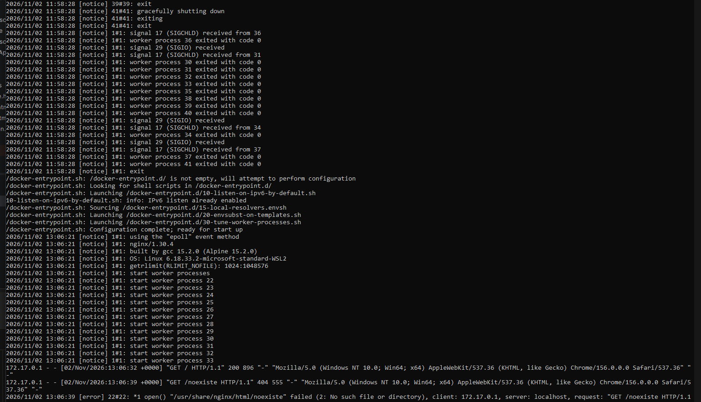
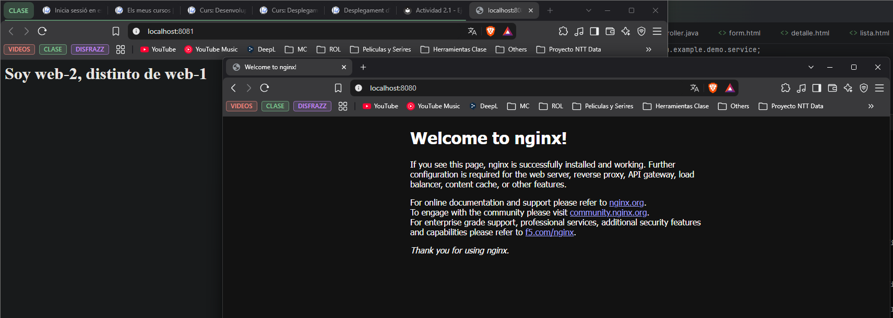
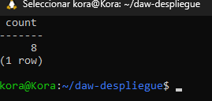
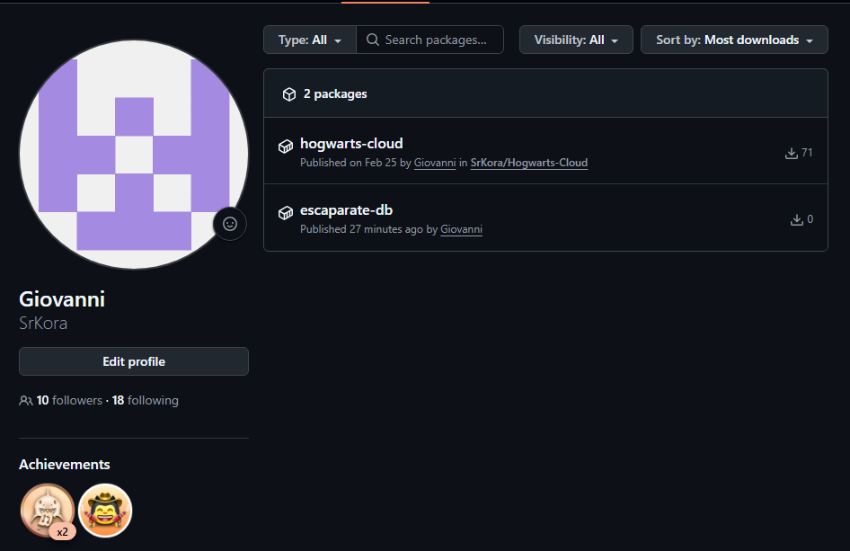
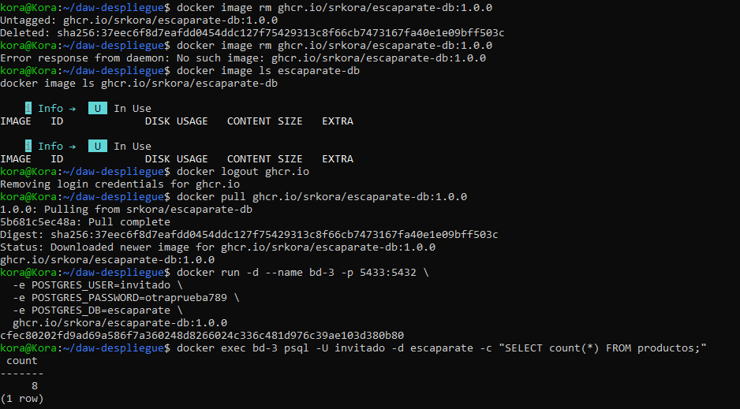

# Actividad 2.1
 
## Paso 3: imágenes y contenedores
 
### ¿Por qué `stop` y `start` conservaron el cambio?
 
Porque `stop` solo para el contenedor, no lo borra. Al hacer `start` vuelve el mismo contenedor con sus ficheros.
 
### ¿Por qué `web-1` y `web-2` podían contener ficheros diferentes?
 
Porque cada contenedor tiene su propia copia de los ficheros. Lo que cambias en uno no afecta al otro, aunque vengan de la misma imagen.
 
### ¿Por qué eliminar y recrear hizo desaparecer la modificación?
 
Porque al eliminar el contenedor se borran sus cambios. El nuevo `web-1` empieza desde cero con los ficheros originales de la imagen.
 
### ¿Qué problema tendría este comportamiento si el fichero modificado contuviera datos importantes?
 
Que se perderían al borrar el contenedor. Para evitarlo hay que guardar los datos fuera del contenedor, por ejemplo con volúmenes.
 
## Paso 6: misma imagen, configuración distinta
 
El esquema y los 8 productos están dentro de la imagen, porque el Dockerfile copia los scripts SQL a `/docker-entrypoint-initdb.d/`. El usuario, la contraseña y el nombre de la base de datos no están en la imagen: se eligen al crear cada contenedor con `-e`.
 
Por eso `bd-1` y `bd-2` se crearon desde la misma imagen con usuarios distintos y los dos tenían los mismos 8 productos. Así una sola imagen sirve para varios entornos, y las contraseñas no se guardan dentro de ella.
 
## Evidencias
 
### Evidencia 1: `web-1` en ejecución y logs
 
`web-1` en marcha y los logs con una petición correcta (200) y otra fallida (404).
 

 
### Evidencia 2: misma imagen, contenido distinto
 
`web-1` y `web-2`, creados desde la misma imagen, muestran páginas distintas.
 

 
### Evidencia 3: consulta sobre `bd-2`
 
Consulta con el nuevo usuario sobre `bd-2`, que devuelve 8 productos.
 

 
### Evidencia 4: imagen pública en GHCR
 
Paquete público en GitHub:
 

 
Descarga desde GHCR después de borrar las copias locales, y consulta con resultado 8:
 

